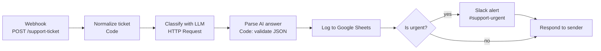

# AI Support Ticket Triage (n8n + LLM)

An **n8n** workflow that reads incoming customer support messages, lets an LLM classify them
(category, priority, sentiment, language), drafts a first reply, logs everything to
**Google Sheets** and alerts the team in **Slack** when a ticket is urgent.

It is based on my experience in online customer support for a grocery shop: most of the time
was spent reading every message just to decide *what it is about* and *how urgent it is*.
This workflow does that first step automatically and works in any language (EN, DE, SK, UK, ...).

## How it works



1. **Webhook** receives a ticket: `{ "email", "subject", "message" }` (e.g. from a contact form or an e-mail parser).
2. **Normalize ticket** cleans the input, adds an id and a timestamp and builds the LLM request.
3. **Classify with LLM** calls any **OpenAI-compatible API** — DeepSeek, Qwen, OpenAI — with retries (3 tries).
4. **Parse AI answer** validates the model output against the schema. If the model returns broken JSON or
   a value outside the schema, safe defaults are used and the ticket is flagged `needs_human_review`.
5. The result is appended to a Google Sheet; **high-priority** tickets also go to Slack.
6. The sender gets a JSON response with the ticket id, category and priority.

## Prompt engineering

The system prompt is in [`prompts/classify-ticket.system.md`](prompts/classify-ticket.system.md). Key decisions:

- **Strict JSON output** with a fixed list of allowed values + `response_format: json_object`.
- **Explicit rules** for categories and priority (e.g. double charge, allergy risk or "nothing arrived" → `high`).
- **Safety rules for replies**: never promise refunds or delivery dates, never invent order numbers.
- `temperature: 0` for consistent results.
- **Defensive parsing** in code — the workflow never trusts the model output blindly.

## Evaluation

[`samples/tickets.json`](samples/tickets.json) contains 12 labelled tickets in 4 languages.
`npm run evaluate` measures category and priority accuracy.

| Classifier | Category accuracy | Priority accuracy |
|------------|-------------------|-------------------|
| Keyword baseline (English rules, no LLM) | 6/12 (50 %) | 6/12 (50 %) |
| LLM (run `npm run evaluate` with your API key and add the result here) | – | – |

```bash
npm run evaluate                                   # keyword baseline
LLM_API_KEY=sk-... LLM_BASE_URL=https://api.deepseek.com LLM_MODEL=deepseek-chat npm run evaluate
LLM_API_KEY=sk-... LLM_BASE_URL=https://dashscope-intl.aliyuncs.com/compatible-mode/v1 LLM_MODEL=qwen-plus npm run evaluate
```

## Setup in n8n

1. In n8n: **Workflows → Import from File** → `workflow/ai-support-ticket-triage.n8n.json`.
2. **Classify with LLM** node → create a *Header Auth* credential:
   name `Authorization`, value `Bearer <your API key>`.
   To switch provider, edit the `CONFIG` line at the top of the **Normalize ticket** node.
3. **Log to Google Sheets** → connect your Google account, paste the spreadsheet ID and create a sheet
   named `Tickets` with this header row:
   `ticket_id, received_at, customer_email, subject, category, priority, sentiment, language, summary, suggested_reply, needs_human_review, parse_problems, message`
4. **Alert support team in Slack** → connect Slack and choose a channel.
5. Activate the workflow and send a test ticket:

```bash
curl -X POST https://<your-n8n>/webhook/support-ticket \
  -H "Content-Type: application/json" \
  -d '{"email":"anna@example.com","subject":"Broken eggs","message":"Order 48213 arrived, 4 of 10 eggs were broken."}'
```

## Development

The JavaScript used inside the n8n Code nodes lives in [`src/triage.js`](src/triage.js), so it can be
unit-tested without n8n. `npm run build` copies it (and the prompt) into the workflow JSON.

```bash
npm test          # unit tests + runs the Code nodes from the exported workflow in a sandbox
npm run build     # regenerate workflow/ai-support-ticket-triage.n8n.json
npm run evaluate  # accuracy on the labelled samples
```

No dependencies — Node.js 18+ only.

## Ideas for the next version

Gmail / IMAP trigger instead of a webhook, automatic reply drafts in the help-desk tool,
a dashboard of ticket categories per week, the same flow built in **Make** for comparison.

---


